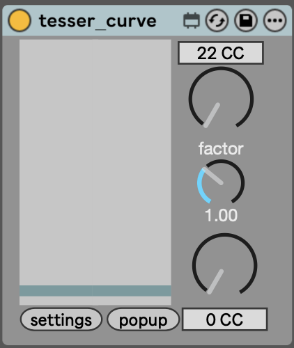

# tesser_curve

---

## credits

[CURVE by SKINNERBOX version 1.0 by skinnerbox on maxforlive.com](https://maxforlive.com/library/device/3894/curve-by-skinnerbox)

---

## Usage

You may enter the values via CC or via clip names.

### via CC

Set the CC to listen to. This is also the CC thevalues will be spitted out.

### via names

You can use the clip names on the device's track as follow:

- Absolute value (E.g. **67**). These values are 0 <> 127

- Percent (E.g. **56%**)

- factor value (E.g. **x1.56**)

---
